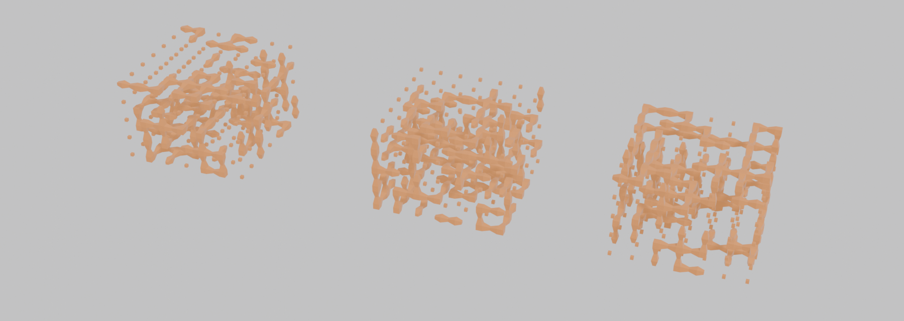
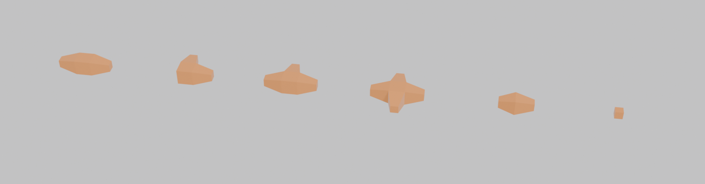
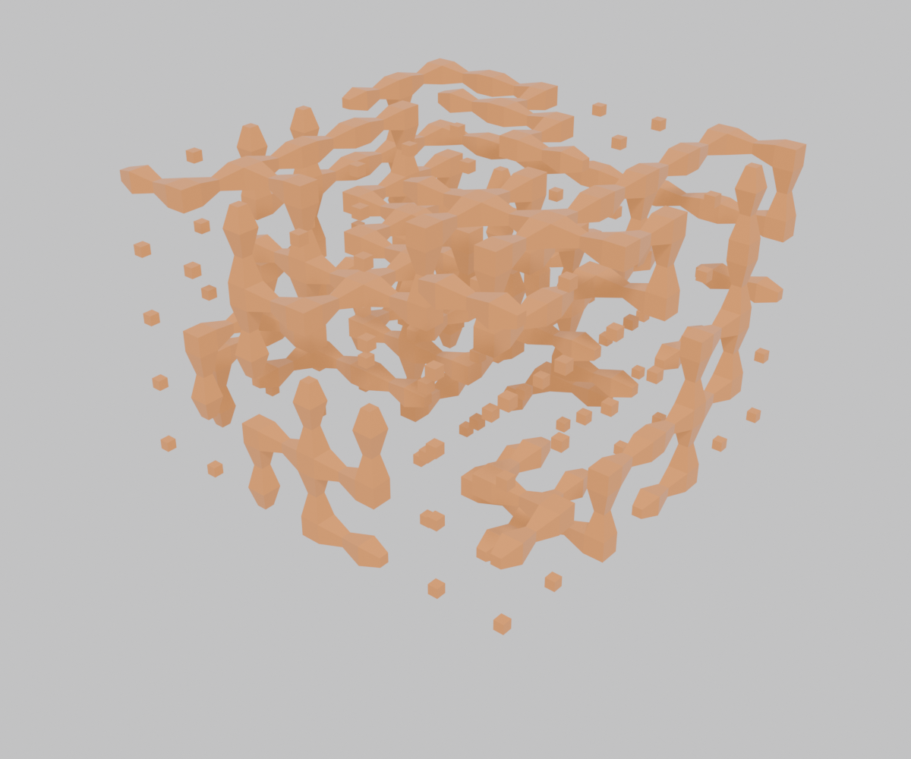
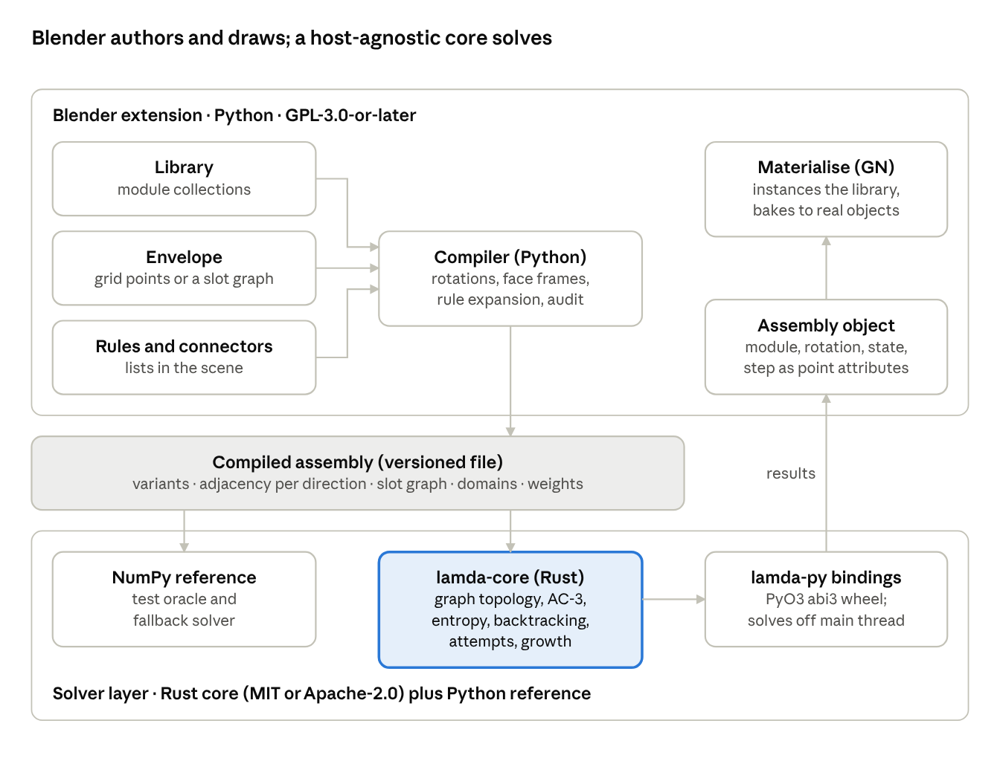

# LamdaFunction

**Wave function collapse for Blender.** Model a small kit of parts, say which faces may touch, and LamdaFunction fills any mesh with them: every neighbour pair fits, every boundary is closed, and the same seed gives the same result on every machine.

Named for the λ in λ = h/p.



<sub>Three seeds, one kit, one envelope: `examples/2pipes.blend`. Every pipe end meets another pipe end; no pipe leaves the box.</sub>

---

## Contents

- [What it does](#what-it-does)
- [Showcase: the 2pipes kit](#showcase-the-2pipes-kit)
- [Install](#install)
- [Quick start](#quick-start)
- [How it works](#how-it-works)
- [Repository layout](#repository-layout)
- [Building from source](#building-from-source)
- [Testing](#testing)
- [Status and roadmap](#status-and-roadmap)
- [Licence](#licence)

## What it does

Wave function collapse (WFC) is a constraint solver dressed up as a generative tool. You give it:

- **a kit**: modules (a pipe elbow, a wall panel, a stair) modelled in a 1 × 1 × 1 cage, each face carrying a **connector** name;
- **rules**: which connectors may meet, and at which twist;
- **an envelope**: any mesh whose vertices are the **slots** to fill, from a simple box to a Geometry Nodes point cloud.

It returns one module and one rotation per slot such that every touching pair of faces is allowed. It picks the most constrained slot, places a part, propagates what that rules out through the whole envelope, and repeats, backtracking when it paints itself into a corner.

In Blender this looks like a sidebar tab and a point cloud:

- **Rotational freedom** per module (none, X, Y, Z or full): the compiler generates the distinct rotations and merges duplicates.
- **Closed or open boundaries**: close the outside with a named connector (such as `0`) so nothing pokes out, or leave it free.
- **Weights and fixed slots**, also painted as point attributes on the envelope (`wfc_w:<module>`, `wfc_fix`).
- **Audit**: before solving, the compiler reports unreachable faces, impossible modules and the slot that empties first, and **Select Culprit** takes you there.
- **Materialise** and **Inspect** Geometry Nodes groups: instance the kit on the solved slots, or colour each slot by state and scrub the timeline to watch the collapse.
- **Deterministic**: the native Rust solver and the pure-Python reference solver produce bit-identical results for the same compiled assembly and seed.
- **Fast**: a 30 × 30 × 21 building study (18,900 slots, 400 variants) propagates and solves in about 0.4 s per attempt on one thread.

## Showcase: the 2pipes kit

`examples/2pipes.blend` is the [pipes tutorial](docs/pipes-tutorial.md) kit scaled up to a 7 × 7 × 5 envelope (245 slots).

**The kit.** Six modules, two connectors. `t` marks a pipe end, `0` a blank face.



| Module | `t` on | `0` on | Distinct rotations |
| --- | --- | --- | --- |
| straight | +X, −X | the other four | 3 |
| elbow | +X, +Y | the other four | 12 |
| tee | +X, −X, +Y | the other three | 12 |
| cross | +X, −X, +Y, −Y | +Z, −Z | 3 |
| cap | +X | the other five | 6 |
| empty | none | all six | 1 |

All six have full rotational freedom, so the solver chooses from **37 variants**.

**The rules.** Two pairs: `t` meets `t`, `0` meets `0`, at any twist. The boundary is closed by `0`, so every face on the outside of the box must be blank.

**The result.** With seed 3 the solver finishes in its first attempt: 242 observations, 0 backtracks, a few milliseconds. The other three slots were decided by propagation alone. Every network is closed, with no loose pipe end anywhere:



Change the seed for another network, or try the variations at the end of the tutorial: weight `straight` up and `cap` down for longer runs, open the boundary, or forbid two caps from facing each other.

The figures are rendered headless from the example file by `scripts/render_readme.py`.

## Install

You need **Blender 5.2 LTS** or newer.

1. Download the zip for your platform from the [releases page](https://github.com/arlav/lamdafunction/releases): `lamdafunction-<version>-windows_x64.zip`, `-macos_arm64.zip`, `-macos_x64.zip` or `-linux_x64.zip`. (Until the first release is tagged, build it yourself: see [Building from source](#building-from-source).)
2. In Blender: **Edit → Preferences → Get Extensions**, open the drop-down at the top right and choose **Install from Disk**. Pick the zip.
3. In **Preferences → Add-ons**, check that **LamdaFunction** is enabled.
4. In the 3D viewport press `N` and open the **LamdaFunction** tab.

Or headless:

```bash
blender --command extension install-file -r user_default --enable lamdafunction-0.1.0-macos_arm64.zip
```

Each zip carries the native solver (`lamda-core`, a Rust wheel) where one is built for that platform, and always the pure-Python reference solver as a fallback. The add-on picks the native one when it loads and falls back silently; both give the same answer.

## Quick start

The full walkthrough, with every click, is [docs/pipes-tutorial.md](docs/pipes-tutorial.md) (also as a [PDF](docs/pipes-tutorial.pdf)). In short:

1. **Library → New Library.** Every child collection of "LamdaFunction Library" is a module. **Add Module** for each part.
2. **Faces and Connectors.** Type a connector name on each of the six faces of each module. The viewport overlay draws the cage and the face arrows.
3. **Rules.** Add connector pairs (`t`–`t`, `0`–`0`) and choose the allowed twists.
4. **Envelope.** **Box Envelope**, or point the envelope field at any mesh. Turn on **Closed boundary** and name the closing connector.
5. **Solve.** **Compile** shows the audit ("37 variants from 6 modules"); **Solve** runs on a worker thread with progress in the status bar (Esc cancels).
6. **Materialise** instances your modules on the result; **Inspect** shows solve state and order.

The result is a "LamdaFunction Assembly" object: one vertex per slot with `wfc_module`, `wfc_rotation`, `wfc_variant`, `wfc_state`, `wfc_step` and friends as point attributes, ready for your own Geometry Nodes.

## How it works



Three layers and one contract between them.

1. **Compiler** (`addon/compile/`, Python, no `bpy`). Turns the kit, the rules and the envelope into a **compiled assembly**: the variants (module × rotation), the allowed variant pairs per port and twist, the slot graph, initial domains, weights, priorities and fixed slots. Face frames and twists are pinned down by an exhaustive test of all 24 rotations against all 6 faces and all 24 × 24 rotation pairs.
2. **Solver**, in two implementations that must agree bit for bit:
   - `lamda-core` (Rust): domains as bitsets, AC-3 propagation over a CSR slot graph, minimum-entropy observation with a versioned heap, an undo trail for backtracking, parallel attempts with `rayon`, and an independent validator that rechecks every result. Its own PCG32 random number generator, so results do not depend on a library version or the OS. `#![forbid(unsafe_code)]`.
   - `reference/` (NumPy): a straightforward port used as the test oracle and as the fallback in Blender. Differential tests solve 2,300 random assemblies with both and require identical arrays.
3. **Blender add-on** (`addon/bl/`): properties, panels, operators, overlay and node groups. Reads the result as plain arrays and writes them as point attributes in one `foreach_set` per attribute (8 attributes × 200,000 points in about 3.5 ms).

Nothing Blender-specific goes below the contract, so `lamda-cli`, the tests and any other host can solve the same JSON file. The schema lives in [`schema/`](schema/).

The design document, with the reasoning behind each choice and the roadmap, is [docs/PLAN.md](docs/PLAN.md). Phase 0 spike reports, with their numbers, are in [docs/spikes/](docs/spikes/).

## Repository layout

```
lamdafunction/
  core/                Rust workspace members, MIT OR Apache-2.0
    lamda-core/        the solver library
    lamda-py/          PyO3 bindings -> the lamda-core wheel (abi3, CPython >= 3.11)
    lamda-cli/         headless solve, validate, bench-gen, bench
  reference/           NumPy reference solver, MIT OR Apache-2.0
  addon/               Blender extension, GPL-3.0-or-later
    model/             data model (no bpy)
    compile/           rotations, face frames, rule expansion, audit (no bpy)
    bl/                Blender UI, operators, node groups, overlay
  schema/              compiled-assembly JSON schema, versioned
  examples/            pipes.blend, 2pipes.blend
  scripts/             build_extension.py, make_examples.py, render_readme.py, md2pdf.py, check_teaching.py
  tests/               python/, blender/, fixtures/
  docs/                PLAN.md, pipes-tutorial.md, spikes/, rust-journal.md, rust-concepts.md
```

The Rust is written as a teaching text as well as a solver: each file introduces a few language concepts in order, with comments that explain them, and `docs/rust-journal.md` records what each step taught. If you are learning Rust, start with [LEARNING.md](LEARNING.md): the reading order, how the comments work, and exercises.

## Building from source

Requirements: Rust 1.85+, Python 3.11+, Blender 5.2+.

```bash
git clone https://github.com/arlav/lamdafunction && cd lamdafunction

# Python environment and the native wheel
python3 -m venv .venv && .venv/bin/pip install numpy pytest maturin
.venv/bin/python -m maturin develop -m core/lamda-py/Cargo.toml                                   # into .venv, for the tests
.venv/bin/python -m maturin build --release -m core/lamda-py/Cargo.toml --out addon/wheels     # for the extension

# Extension zips, one per platform, into dist/
python scripts/build_extension.py        # finds your newest Blender, or pass --blender <path>
```

`build_extension.py` vendors the reference solver into the add-on, writes the wheel list in `addon/blender_manifest.toml` from whatever is in `addon/wheels/`, and runs `blender --command extension build --split-platforms`. A zip built without a wheel for its platform still works, on the Python solver.

Headless solving and benchmarks:

```bash
cargo build --release -p lamda-cli
target/release/lamda-cli bench-gen --slots 30x30x21 --variants 400 --seed 1 --out study.json
target/release/lamda-cli bench study.json --repeat 3
```

## Testing

```bash
# Rust: format, lints, unit, property and doc tests
cargo fmt --all
cargo clippy --workspace --all-targets -- -D warnings
cargo test --workspace

# Python: model, compiler, reference solver, bindings, Rust-vs-Python differential tests
.venv/bin/python -m pytest addon/model addon/compile reference tests/python -q

# Blender, headless: compiles, solves and materialises the pipes kit and checks a pinned attribute hash
blender -b --factory-startup --python-exit-code 1 --python tests/blender/run_all.py
LAMDA_NO_WHEEL=1 blender -b --factory-startup --python-exit-code 1 --python tests/blender/test_pipes.py   # Python-solver path
```

CI (`.github/workflows/ci.yml`) builds wheels for Windows x64, Linux x64, macOS arm64 and macOS x64, runs all three suites (Blender on Linux and Windows), and on a `v*` tag publishes the zips, the tutorial PDF and the example file as a GitHub release.

## Status and roadmap

**Version 0.1.0, alpha.** Phase 1 (the MVP) is built and tested headless on Blender 5.2.2 LTS; its gate is a newcomer rebuilding the pipes kit from the tutorial alone. Expect UI changes as that happens.

| Phase | Scope |
| --- | --- |
| 0, spikes | Done: collection ordering, face frames and twists, the wheel inside Blender, bitset benchmark, attribute write speed |
| 1, MVP | Built: single-cell modules, connectors and rules, rotational freedom, box and mesh envelopes, boundaries, audit, Materialise and Inspect |
| 2 | Multi-cell modules, connector twists in the UI, weights as attributes, growth mode with supply caps, partial re-solve, seed browser |
| 3 and research | Global constraints (connectivity, support, counts, symmetry), solving in blocks, learning rules from examples, SpaceTope layouts as envelopes, IFC export through Bonsai |

Backtracking and parallel attempts are already in both solvers.

## Licence

- `core/` and `reference/`: **MIT OR Apache-2.0**, at your option ([LICENSE-MIT](LICENSE-MIT), [LICENSE-APACHE](LICENSE-APACHE)).
- `addon/`: **GPL-3.0-or-later**, as Blender add-ons must be ([addon/LICENSE](addon/LICENSE), shipped inside every extension zip).

The permissive licence on the solver lets other hosts and tools reuse it; Apache-2.0 and MIT are both compatible with the GPL, so the extension can bundle it. Every source file carries an SPDX line. Copyright 2026 Theo Dounas.

LamdaFunction is made by Theo Dounas, [Adventurous Systems](https://github.com/arlav). Issues and pull requests are welcome.
