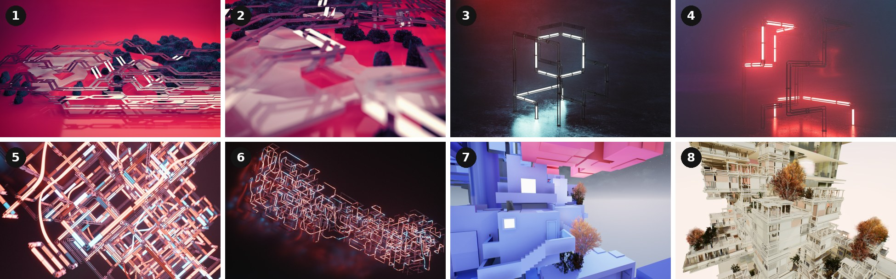
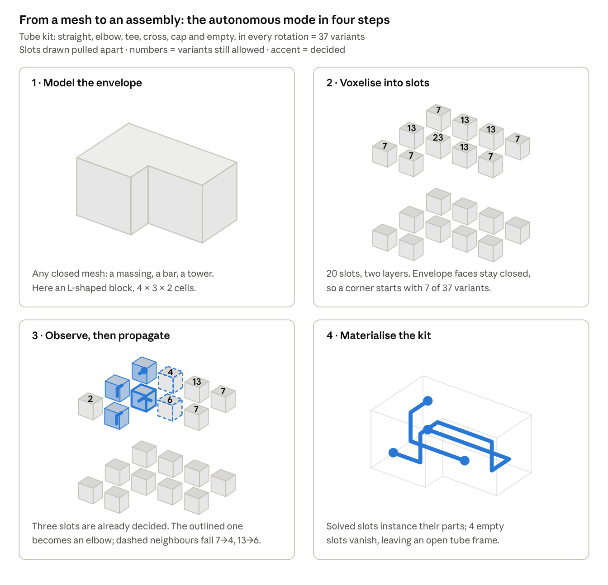
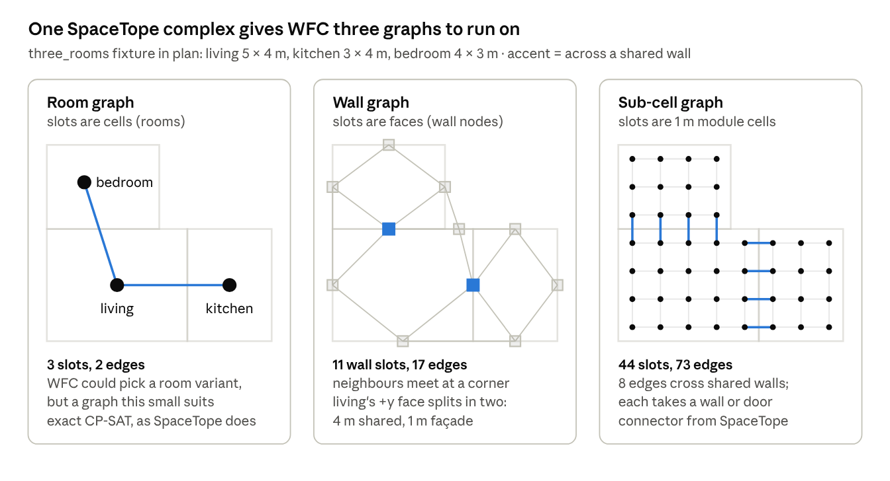
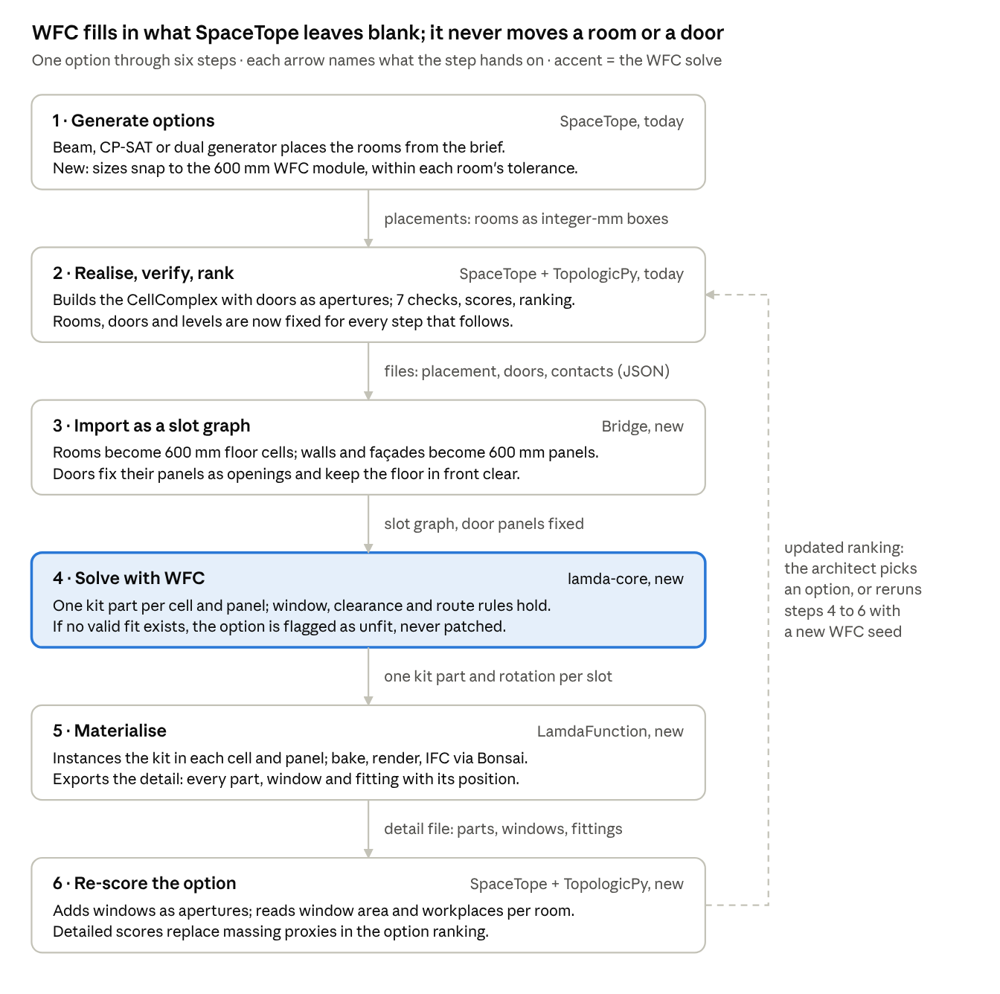
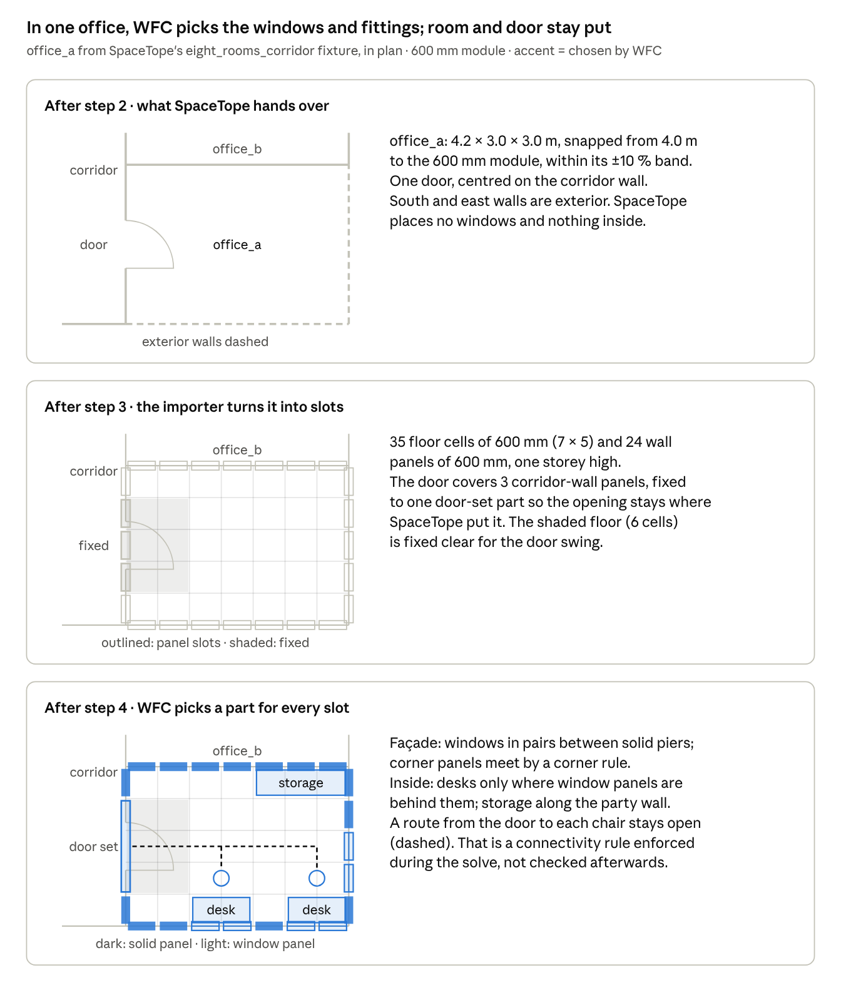
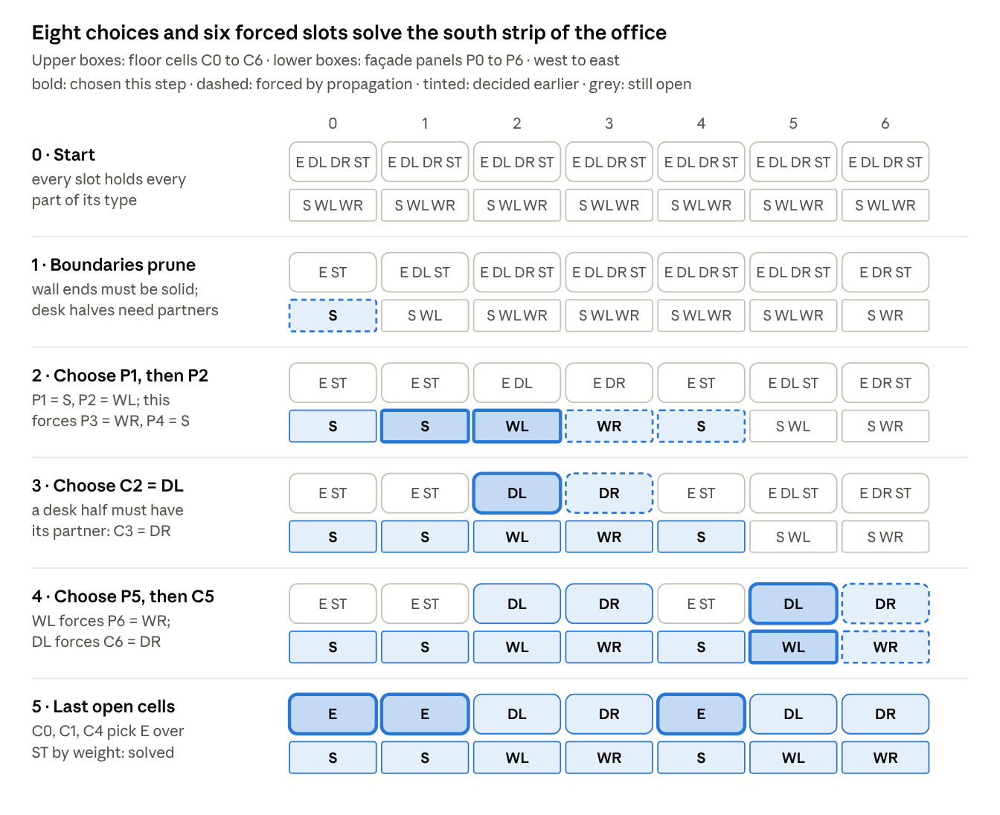
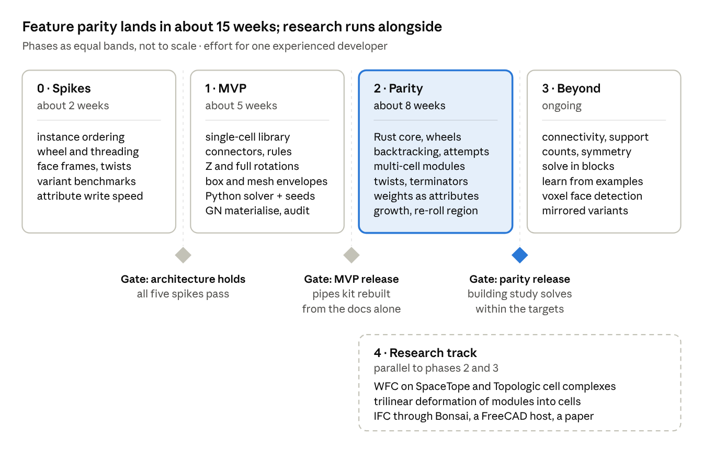

# LamdaFunction — architecture & build plan

> Design source of truth for this repository. `CLAUDE.md` summarises it and the files in `.claude/rules/` make parts of it precise; where a rule and this plan differ on a detail, the rule wins and this plan should be updated to match.
>
> Changes since the plan shared on 15 October 2026: parallel attempts return the lowest-numbered success (determinism); the observation heap uses versioned lazy deletion; `wfc_cell` is a float vector; the module property group and sidebar tab are named `lamdafunction` / "LamdaFunction"; the example kits are pipes, tubes, office, facade and house.

Theo Dounas · Adventurous Systems · exported 15 October 2026

## Summary

Build LamdaFunction, named for the λ in λ = h/p: a wave function collapse tool for Blender that fills a mesh, or a SpaceTope layout, with a kit of modular parts. A host-agnostic Rust core does the solving; a thin Blender extension authors kits and draws results through point attributes and Geometry Nodes.

The decisions that shape everything else:

- **Target Monoceros 3, not 1.** Monoceros is now a commercial product, and its current feature set (weights, backtracking, connectors with twist, terminators, growth solver, audit) is what users mean by "works like Monoceros". Work clean-room from its public manual.
- **Two layers, two licences.** `lamda-core` in Rust (MIT/Apache-2.0, shipped to PyPI as an abi3 wheel) and a Blender extension in Python (GPL-3.0-or-later, which the extensions platform requires).
- **Solve on a graph, not a 3D array.** Slots are nodes with labelled face-adjacencies, so heterogeneous grids work now and cell complexes (SpaceTope, Topologic) work later without a rewrite.
- **Blender-native data.** The envelope is a point object; per-slot weights, priorities and fixes are point attributes you can author with Geometry Nodes; results are attributes; a shipped node group instances the module collections. Everything stays non-destructive and renderable.
- **Python reference first, Rust second.** A NumPy solver gets the UX moving, then becomes the test oracle and fallback. Both share one seeded RNG so results can match bit for bit.
- **Neither linked repo is the foundation.** mxgmn's repo is the algorithm reference; wfc-rs is 2D-only with no licence file. The useful code is Subdigital's own Rust core behind the original Monoceros, which is public domain (Unlicense).

Rough effort for one experienced developer: spikes 2 weeks, single-cell MVP about 5 weeks, Monoceros 3 parity about 8 more, then open-ended research work.

## The parity target in 2026

The parity target is Monoceros 3: versions 1 and 2 are withdrawn, and version 3 is a redesign sold under an EULA ([archive](https://www.monoceros.tools/archive/), [download and licences](https://www.monoceros.tools/tools/grasshopper/)).

|  | Monoceros 1 | Monoceros 2 | Monoceros 3 (current) |
| --- | --- | --- | --- |
| Modules per run | up to 248 | up to 1,014 | up to 16,384 |
| Solver | single-threaded | parallel attempts | parallel attempts with backtracking |
| Rotations | modelled by hand | separate Rotations step | automatic, up to 24 per module, deduplicated |
| Cell sizes | uniform | mixed | mixed |
| Weights | none | per slot, per module | per slot, per module |
| Boundary | added automatically | wired by hand | wired by hand, or Terminators |
| Price | free | free | free tier with rate-limited runs; $149/year or $399 lifetime per seat |

What to match, taken from the [Monoceros 3 manual](https://www.monoceros.tools/monoceros-reference.txt):

- **Data types:** Cell, Slot (allowed modules plus a weight each), Module (name, one or more face-connected cells, optional geometry, rotational freedom None/X/Y/Z/Full), Face IDs `+X`…`-Z` with a cell ordinal on multi-cell modules, Rule (`a:+X -> b:-X`), Connector (name on a face plus a quarter-turn offset), Connector Pair (two names plus four twist permissions 0/90/180/270), Terminator, Assembly.
- **Assembly build:** rotation expansion, connector-generated rules, allowed/disallowed/exclusive rules and pairs, Indifference for uncovered faces, optional clean-up, full audit.
- **Solvers:** WFC (seed, max attempts, return-first, max observations, partial results that a second run can continue) and Growth (frontier growth, supply caps, stop-when-settled).
- **Slot control:** per-module weights (weight ≤ 0 removes the module), slot priorities, allow-all slots resolved by cell size.
- **Envelope tools:** homogeneous and heterogeneous grids, cells from geometry (surface wrap / fill volume), boundary layers, boundary detection, neighbour queries.

Two semantics to copy deliberately, because Grasshopper users will expect them: an explicit rule between two rotatable modules pairs only same-rotation variants, and a rule between non-opposing faces acts as a rotation hint rather than an error.

Work clean-room: concepts from the public manual are generic WFC vocabulary, but don't copy its text, UI or branding, and don't use "Monoceros" in the product name.

## Prior art and what we take from it

Nothing out there does this in Blender yet: the one WFC extension on the Blender platform is pure Python with a simple solver, and the two repos you linked are references, not foundations.

| Project | What it is | Licence | What we take |
| --- | --- | --- | --- |
| [mxgmn/WaveFunctionCollapse](https://github.com/mxgmn/WaveFunctionCollapse) | C# original: overlapping and simple tiled models, AC-4 propagation, lowest-entropy observation, D4 tile symmetry | MIT | Entropy bookkeeping, AC-4 propagator, symmetry thinking. Its 3D tiled model lives in MarkovJunior. Its README is the best map of the field. |
| [bbstilson/wfc-rs](https://github.com/bbstilson/wfc-rs) | Small Rust CLI for 2D images (overlap and tile modes, rotations/reflections, GIF output); its own TODO lists Shannon entropy and voxels | No licence file | Readable Rust for the overlapping model. Not reusable: no licence means no rights. |
| [subdgtl/WFC](https://github.com/subdgtl/WFC) | Rust `wfc_core` 3D voxel solver, CLI, C dylib and a minimal Grasshopper component; the solver behind the original Monoceros | Unlicense | Closest prior art for our core. Read its world and rule representation; fork only if it scales past Monoceros 1's 248-module ceiling. |
| [WFC 3D Generator](https://extensions.blender.org/add-ons/wfc-3d-generator/) | Pure-Python Blender extension with neighbour, connector, geometry, frequency, region and symmetry constraints; about 9,200 downloads | GPL-3.0+ | The incumbent. Its constraint list is a good checklist; its documented loop picks the shortest candidate list and has no backtracking or weighted entropy, and reviews flag docs and usability. |
| [ghx\_proc\_gen](https://docs.rs/ghx_proc_gen) | Rust 2D/3D model synthesis with AC-4, sockets and rotated model variants (Bevy integration) | Check before reuse | Second reference for socket rotation and a Rust API shape. |
| DeBroglie, Tessera, model synthesis | Boris the Brave's C# library (hex grids, extra constraints, backtracking); Merrell's model synthesis and modifying-in-blocks; Karth and Smith on backtracking and heuristics | Varies | Designs for global constraints, backtracking and very large envelopes. Links are in the mxgmn README. |

Monoceros itself is a "simple tiled model" in mxgmn's terms: adjacency rules between authored modules, not patterns learned from an image. The overlapping model matters only if you later want "learn a style from an example voxel model".

## Architecture

Three layers with one contract between them: Blender authors and draws, a versioned compiled-assembly file carries the problem, and a host-agnostic solver layer returns plain arrays.


Everything Blender-specific stays above the contract, so the Rust core, the NumPy reference, a CLI or another host such as FreeCAD can solve the same setup.

## Two ways to use it

LamdaFunction has one engine and two front doors. In autonomous mode you give it a mesh and a kit and it fills the mesh. In SpaceTope mode, SpaceTope fixes rooms and doors first and WFC only details inside them. Both share the compiler, the solver and the materialiser; they differ in where slots and fixed cells come from.

|  | Autonomous mode | SpaceTope mode |
| --- | --- | --- |
| Input | Any closed mesh, plus a kit | A SpaceTope option (rooms, walls, doors), plus a kit |
| Slots | Voxels of the mesh, one per cell | Floor cells and wall panels from the importer, at 600 mm |
| Fixed before the solve | Painted slots; envelope faces closed | Door sets, clear floor, structure |
| What WFC decides | Everything inside the envelope | Façades, partitions, fit-out, ceilings |
| Rules come from | Kit connectors and hand-written rules | The same, plus programme tags per room |
| Checks | Audit, then optional global constraints | Audit, then SpaceTope re-scores the result |
| Who decides the layout | WFC | SpaceTope |
| Output | An assembly to render or bake | A detailed option, re-ranked against the others |

### What the output might look like

Your eight references fall into three kits. All three are autonomous-mode work; the housing kit is also where SpaceTope mode pays off.



| Image | What it shows | Kit it implies |
| --- | --- | --- |
| 1, 2 | White strips with 45° jogs, stacked in layers over red terrain and dark bushes | A rail kit: straight, jog, merge, layer step and end. A jog moves a lane sideways inside one cell, so each face's connector names its lane positions (for example "L13" for lanes 1 and 3). Bushes are a filler part for slots outside the rails |
| 3, 4 | One or two neon tube frames in a dark room | The six-piece tube kit in the drawing below, sparse: weight empty high, and use a lit variant of straight |
| 5, 6 | A dense lattice of glowing tubes filling a bar | The same tube kit, empty weighted low, tees and crosses allowed, a bar mesh as the envelope |
| 7 | Lilac housing with stairs, terraces, trees, and a pink block floating overhead | A housing kit: multi-cell flats, stairs, terraces, tree pots and an empty part. The floating block is what a solve gives without the support rule |
| 8 | A white tower of flats, balconies and trees | The housing kit in a tall envelope, with the support rule and a circulation rule so every flat reaches a stair |

Images 7 and 8 need the global constraints in "Beyond parity" (support and connectivity). Local adjacency alone cannot stop a block floating or a flat being cut off.

### Autonomous mode, play by play

This is LamdaFunction's core workflow, shown with the tube kit of images 3 to 6.



1. **Model the envelope.** Any closed mesh: a bar for images 5 and 6, a tower for 8, a terrain slab for 1 and 2. Add the "LamdaFunction Envelope" Geometry Nodes asset. It voxelises the mesh at a cell size you set and writes one point per slot with `wfc_cell` and `wfc_size`. Edit the mesh or the cell size and the slots update.
2. **Author the kit.** Each module is a child collection of "LamdaFunction Library", modelled in a unit cage. The tube kit is six modules: straight, elbow, tee, cross, cap and empty. Name each face's connector: "t" where a tube meets the face, "0" where it is blank. Set rotation to Full and the compiler generates 37 distinct variants. Empty is a real module, "0" on every face.
3. **Paint the field.** Weights, priorities and fixed slots are point attributes, so Geometry Nodes paints them. A noise texture on `wfc_w:empty` thins the lattice in patches; a vertex group sets `wfc_fix` to cap on the floor to plant light fittings. Boundary faces take the terminator "0", which closes the frame: that is why a corner slot starts with 7 of 37 variants.
4. **Compile and audit.** One click compiles kit and slots into the assembly contract. The audit then lists connectors with no partner, modules no slot can hold and boundary faces nothing can close, before any solve runs.
5. **Solve, watching the superposition.** The solve runs on a worker thread while "LamdaFunction Inspect" greys each slot by options left. Each step observes the lowest-entropy slot, picks one variant by weight (ties broken by the seed) and propagates. Panel 3 is one step: the outlined slot has 6 options; once it is an elbow, two neighbours fall from 7 to 4 and from 13 to 6. A contradiction backtracks; parallel attempts with different seeds run, and the lowest-numbered success wins, so the result never depends on thread timing. Each slot records `wfc_step`, the order it collapsed in.
6. **Materialise.** "LamdaFunction Materialise" instances each solved slot's module at its point, using `wfc_module` and `wfc_rotation`; empty slots draw nothing. Emission materials give images 3 to 6 their glow. Scrub the timeline to replay the collapse from `wfc_step`.
7. **Iterate.** Change the seed for another variant. Lock a region you like and re-solve the rest. Switch to growth mode with supply caps to grow a frame from one seed slot instead of filling the whole envelope. Bake to real objects for export.

### SpaceTope mode, in short

SpaceTope decides rooms and doors. The importer turns its wall-node graph into slots, fixes door sets and clear floor, and tags each room's programme. WFC then runs steps 4 to 6 above on façades, partitions, fit-out and ceilings, and SpaceTope re-scores the result with windows as apertures. [The integrated pipeline](#the-integrated-pipeline) and [the worked example](#worked-example-one-office) show it step by step.

### Where the two modes meet

- **One kit, both modes.** A kit authored for autonomous mode works in SpaceTope mode once its parts fit the 600 mm module and carry programme tags.
- **One check, both modes.** Any assembly can go to TopologicPy as a cell complex, so autonomous results get the same graph metrics (connectivity, reach) as SpaceTope options.
- **A hybrid for housing.** SpaceTope fixes the flats as fixed slots; autonomous mode fills the rest of the envelope with stairs, terraces and trees around them. That is the most direct route to images 7 and 8.

## Concept mapping: Monoceros 3 to Blender

Every Monoceros 3 concept has a Blender home; most become a property on a collection, a point attribute, or a Geometry Nodes asset.

| Monoceros 3 | Blender equivalent | Phase |
| --- | --- | --- |
| Module (name, cells, geometry) | A collection inside a "LamdaFunction Library" collection, with a `lamdafunction` property group: name, footprint cells (anchor first), default weight, tags | 1 single-cell, 2 multi-cell |
| Rotational Freedom | Enum on the module: None / X / Y / Z / Full; variants exist only in the compiled assembly, never as objects | 1 |
| Module preview | GPU overlay: cell cage, axis-coloured face arrows, face labels, name | 1 |
| Face ID (`+X`…`-Z`, cell ordinal) | Same text syntax, so rules paste between tools | 1 |
| Rule (allowed / disallowed / exclusive) | Scene-level rule list with text entry `a:+X -> b:-X`, "rule from two selected faces", and "rule from a line drawn between faces" | 1, 2 |
| Connector, Connector Pair, twist flags | Per-face connector name plus quarter-turn offset; a scene-level pair table with four twist checkboxes | names 1, twists 2 |
| Terminator, Require Terminators | Per-face toggle; solver setting | 2 |
| Indifference | Solver setting, on by default | 1 |
| Detect Rules from Geometry / Voxels | Operator that samples each face's boundary geometry, canonicalises it and hashes it into connector names | 2 geometry, 3 voxels |
| Touching Faces from Slots | "Learn rules from example": place module instances by hand, extract every touching face pair | 2 |
| Cell, Homogeneous / Heterogeneous Grid | Envelope object: one vertex per slot centre, `wfc_cell` attribute (a float vector holding whole numbers, because Blender has no 3-component integer attribute), optional `wfc_size`; box and size-list operators | 1, 2 |
| Cells from Geometry | Operator plus GN asset: voxelise a mesh by surface wrap, fill volume, or both | 1 |
| Add Boundary Layer, Are Cells Boundary, Neighbor Cells | GN assets on the envelope: dilate, boundary flag, n-ring selection | 2 |
| Slot allowed modules and weights | Float point attributes `wfc_w:<module>` or `wfc_w:#<tag>`; ≤ 0 removes the module; authored with GN (proximity, noise, painted masks) | 2 |
| Slot Priorities | Int point attribute `wfc_priority` | 2 |
| Construct Assembly + Audit | "Compile" operator producing a versioned compiled-assembly JSON and an audit panel | 1 |
| WFC Solver | "Solve" operator: seed, attempts, return-first, max observations, backtrack budget, threads; runs in the background | 1 Python, 2 Rust |
| Multiple solutions | "Solve variations": N seeds into a seed browser on one Assembly object | 2 |
| Growth Solver, supply caps | Solver mode "Grow" with a supply table | 2 |
| Materialize Assembly | Assembly object plus a shipped "LamdaFunction Materialise" node group that instances the library; "Bake" to real objects or collection instances | 1 |
| Export Project | JSON export of compiled assembly plus solve state | 2 |

## Rule compiler

The compiler turns authored modules, connectors and rules into one symmetric adjacency table over solver variants. Most silent bugs in WFC tools live here, so it gets a written spec and exhaustive tests before any UI.

### Variants

A solver variant is (module, rotation, part). Rotations come from the 24 proper rotations of the cube; rotational freedom picks the subset (None 1, X/Y/Z 4 each, Full 24). Two rotations of one module whose rotated face signatures and rotated geometry hash match are the same variant, so keep one. Mirroring (48 elements, negative-scale instances) is a later option.

### Face frames and twist

Every face direction gets a fixed in-plane frame, so connector offsets and twists have one meaning everywhere.

| Face | Outward normal | Reference axis u | Second axis v |
| --- | --- | --- | --- |
| +X | (1, 0, 0) | +Y | +Z |
| -X | (-1, 0, 0) | -Y | +Z |
| +Y | (0, 1, 0) | +Z | +X |
| -Y | (0, -1, 0) | -Z | +X |
| +Z | (0, 0, 1) | +X | +Y |
| -Z | (0, 0, -1) | -X | +Y |

Each frame is right-handed (u × v = outward normal).

- A connector with offset k points along u, turned k quarter turns about the outward normal.
- Rotating a module moves each face and its arrow; precompute a 24 × 6 table of (new face, offset change).
- When face d of variant A meets face opp(d) of variant B, the relative twist is the angle between the two world-space arrows about A's normal. A connector pair allows the touch when both names match and that twist's flag is set. A name pairs with itself only when declared, as in Monoceros 3.
- Define the twist function once, from world-space arrows, and test all 24 × 24 rotation pairs against a physical keyed pin-and-slot example. Done in spike 2 (`docs/spikes/02-face-frames-twist.md`, `addon/compile/frames.py`): twist is the same number from both sides, and in offsets it is `(2 − k_a − k_b) mod 4`, because opposite faces' frames are mirror images.

This is what makes top and bottom faces rotation-aware, which plain socket-name systems get wrong.

### Multi-cell modules

Split each module into parts, one per cell. Every internal face pair gets an exclusive rule (part i to part j, same module, same rotation), so placing any part forces the whole rigid body. External faces carry ordinals (`+X0`, `+X1`). Rotation permutes part positions with the footprint. Only the anchor part is materialised.

### Build order

1. Resolve library, footprints and cell sizes.
2. Expand and deduplicate rotations.
3. Transform connectors onto each variant.
4. Generate rules from allowed connector pairs and twist masks.
5. Add explicit allowed rules: both sides rotatable pairs same rotations only; one side rotatable permutes that side; non-opposing faces act as a rotation hint.
6. Remove disallowed rules and pairs through every rotation.
7. Apply exclusive rules and pairs: drop all other rules on those faces.
8. Indifference: each uncovered face may meet any uncovered opposite face.
9. Add internal multi-cell rules.
10. Build per-direction adjacency bitsets and assert symmetry.
11. Build slot domains: allowed modules × cell-size fit × terminators on exposed faces. Split a module's weight across its variants, so a 24-rotation module is not 24 times likelier than a fixed one, and say so in the docs.
12. Canonicalise with one propagation pass. A contradiction here is a setup error, not bad luck.

### Audit

Run before every solve and list, each item clickable to select the culprit in the viewport:

- uncovered faces when Indifference is off
- rules or connectors naming missing modules (warn and continue, as Monoceros 3 does)
- slots with no fitting module, and modules left with no live variant after canonicalisation
- exclusive rules that contradict each other
- variant count against the performance budget

### Output contract

The compiler emits a versioned compiled-assembly file (JSON, with a binary twin for big envelopes): variants, per-direction adjacency, slot graph, domains, weights, priorities, boundary classes. The same file feeds the Rust core, the Python reference, the CLI and the tests. The exact fields are in `.claude/rules/solver-core.md` and `schema/compiled-assembly-v1.json`; boundary requirements travel as variant lists per connector, so the core never sees connector names.

## Solver design

One engine over a slot graph covers WFC, growth and partial re-solve. Speed comes from bitsets, incremental entropy and parallel attempts; robustness from a bounded backtracking trail.

### Topology

- Slots are nodes; each has ports (6 on a box grid) and each edge stores (port on A, port on B, twist). Twist is always 0 on orthogonal grids and becomes non-zero on cell complexes later. Store it as compressed arrays, not a 3D array.
- A port with no neighbour follows the boundary policy: free (default), terminator required, or a virtual boundary module.

### State

- Each slot's domain is a bitset over variants. Memory is slots × variants / 8 bytes: 50,000 slots × 2,000 variants is 12.5 MB, fine. Monoceros-scale libraries of 16,000 variants need sparse domains once a domain shrinks, so plan the type behind a trait.
- Each slot keeps a running weight sum and weight-log-weight sum, so entropy updates in constant time per removal (mxgmn's trick).

### Propagation

- Start with bitset AC-3: when a slot changes, OR the allowed-neighbour masks of its remaining variants per port, AND that into the neighbour, and queue the neighbour if it shrank.
- Optimise only on benchmark evidence, in this order: cache the full-domain support mask; derive support from the removed set when fewer were removed than remain; switch to AC-4 counters for large variant counts.

### Observation

- Pick the highest slot priority, then the lowest weighted Shannon entropy, ties broken by small seeded noise. Keep a binary heap with lazy deletion: each entry carries a per-slot version number, and stale entries are skipped when popped.
- Choose a variant with probability proportional to its effective weight (slot weight × variant share).
- Offer alternative orders as options: scanline bottom-up (good for gravity-like kits), growth from a seed point, and minimum remaining values.

### Contradictions and attempts

- Log every domain change on a trail with decision marks. On a contradiction, undo to the last decision, forbid that choice, propagate, and continue until a backtrack budget runs out; then restart with the next seed.
- Match Monoceros 3 attempt semantics: the first attempt runs alone with the given seed; further attempts run in parallel with seeds +1, +2, …; return the lowest-numbered full solution (not whichever thread finishes first, so results stay deterministic), or all non-contradictory ones.
- Max observations stops early and returns a partial result that a later run can resume.

### Growth mode

Add an internal "empty" candidate that accepts any neighbour. Grow from the frontier of slots touching placed modules, decrement supply caps once per authored module instance, and treat settling empty as a valid outcome.

### Partial re-solve

Lock everything outside a selected region, reset the region's domains, propagate inward from its border, and solve. Same engine, and it gives you "re-roll this corner" for free.

### Determinism

Use one RNG, PCG32, implemented identically in Rust and Python. Consume it in a fixed order, keep hash-map iteration out of decision paths, and break exact ties by slot index. Same seed and same compiled assembly then give the same result on every platform and in both implementations.

### Performance targets to validate

| Case | Slots | Variants | Rust, per attempt | Python reference |
| --- | --- | --- | --- | --- |
| Small kit | 500 | 50 | under 50 ms | under 2 s |
| Building study | about 19,000 | 400 | under 1 s | not a goal |
| Large envelope | 200,000 | 400 | under 15 s, or solve in blocks | not supported |

These are targets for the spikes to confirm or revise, not measurements.

### Progress and cancel

The core releases Python's lock while solving, publishes atomic counters (observations, collapsed slots, backtracks, attempt) for Blender to poll, and checks a cancel flag every few hundred steps.

### Solver, step by step

Computationally, WFC is pairwise constraint propagation over bitsets, repeated weighted random choices at the most constrained slot, and undo when a choice fails. The walkthrough uses the office's south wall from the kit section below: 7 façade panels and the 7 floor cells in front of them. Every number was computed, not estimated.

**What the computer holds**

| Structure | On the office wall | At building scale |
| --- | --- | --- |
| Parts as bits | Panels: S = `001`, WL = `010`, WR = `100`; cells use four bits for E, DL, DR, ST | One bit per variant: 400 variants fit in 7 words of 64 bits |
| Domain per slot | One integer per slot, 14 in all: the parts still allowed there | One short row of words per slot |
| Adjacency tables | Along the wall, west to east: S → `011`, WL → `100`, WR → `001`. Panel to cell: S → {E, ST}, WL → {E, DL}, WR → {E, DR}. Each table also exists reversed | One table per port class and twist, shared by every edge of that type |
| Slot graph | 14 nodes and 19 edges: 6 between panels, 6 between cells, 7 from each panel to its cell | Adjacency lists |
| Weights | S 1, WL 2, WR 2, E 2, ST 1, DL 8, DR 8 | Per slot and variant, from weight attributes |
| Bookkeeping | A generator started from the seed, a queue of slots to recheck, and an undo trail | The same |

1. **Initialise.** Every panel starts at `111` and every cell at `1111`. Boundary rules then apply: P0 = `001`, because only S may end a run; P6 = {S, WR}, from the corner rule; C0 loses DR and C6 loses DL, because a desk half needs its partner. Every changed slot goes on the queue.
2. **Propagate.** Take a slot off the queue. For each neighbour, OR together the table rows of every part still in the slot (the support), AND the neighbour with it, and queue the neighbour if it shrank. A neighbour reaching zero is a contradiction. On the bits: P0 = `001` gives support table\[S\] = `011`, so P1 = `111 & 011` = {S, WL}, which shrank and is queued. P1 = `011` gives support `011 | 100` = `111`, so P2 is unchanged and nothing more is queued. When the queue empties, the wall is in state 1 of the drawing.
3. **Observe.** For every open slot, compute the weighted Shannon entropy below, take the lowest (the seed breaks ties), and draw one part in proportion to its weight. {S, WL} and {E, ST} both give 0.637; {E, DL} gives 0.500, because the heavy desk makes the outcome nearly certain; a full cell gives 1.120. Running sums of w and w ln w per slot make each entropy a constant-time update.
4. **Repeat** until every slot holds one part. The table below is the run in the drawing.
5. **Finish or recover.** With one bit per slot, read off part and rotation and write them as point attributes for Geometry Nodes. If a slot reaches zero, walk the trail back to the last choice, restore the masks, remove that choice from that slot, and propagate again. After a set budget of undos, restart with seed + 1; several such attempts can run in parallel.

$$
H = \ln\Bigl(\sum_i w_i\Bigr) - \frac{\sum_i w_i \ln w_i}{\sum_i w_i}
$$

```
while queue not empty:
    s = queue.pop()
    for (n, table) in neighbours(s):
        support = OR(table[p] for p in bits(domain[s]))
        new = domain[n] & support
        if new != domain[n]:
            trail.push(n, domain[n]); domain[n] = new
            if new == 0: return CONTRADICTION
            queue.push(n)
```

| Choice | Lowest entropy (tied slots) | Choice (probability) | Forced or narrowed by propagation |
| --- | --- | --- | --- |
| 1 | 0.637 (C0, P1, P6) | P1 = S (1/3) | P2 → {S, WL}; C1 → {E, ST}; C2 → {E, DL, ST} |
| 2 | 0.637 (C0, C1, P2, P6) | P2 = WL (2/3) | P3 = WR; P4 = S; P5 → {S, WL}; C2 → {E, DL}; C3 → {E, DR}; C4 → {E, ST} |
| 3 | 0.500 (C2, C3) | C2 = DL (0.8) | C3 = DR |
| 4 | 0.637 (C0, C1, C4, P5, P6) | P5 = WL (2/3) | P6 = WR; C5 → {E, DL}; C6 → {E, DR} |
| 5 | 0.500 (C5, C6) | C5 = DL (0.8) | C6 = DR |
| 6–8 | 0.637 (C0, C1, C4) | E each time (2/3 each) | Nothing |

Eight choices and six forced slots settle all 14. Counted exhaustively, this strip has 9 valid façades and 544 valid strips; the seed picks one of them. Contradictions are possible because propagation only checks pairs of neighbours, so conflicts that need a wider view, such as a loop of rules or a count like "at least one window", can surface late.

Cost: each part leaves each slot at most once, so total work grows with slots × variants × neighbours × words per mask. Spike 4 measures what that means in seconds at 400, 2,000 and 16,000 variants.

## Graphs, grids and the SpaceTope + TopologicPy integration

WFC is constraint propagation over a graph, and a 3D grid is just the graph you never have to store. Making the graph explicit costs one lookup per neighbour and buys irregular cells, room-aware boundaries and the graph-algorithm toolbox, which is what a SpaceTope cell complex needs.

### The same algorithm on two data structures

| Aspect | 3D grid (Monoceros) | Cell-complex graph (SpaceTope, TopologicPy) |
| --- | --- | --- |
| Finding a neighbour | Index arithmetic: (i ± 1, j, k) and so on | Adjacency lists built from shared faces |
| Neighbours per slot | Always 6 | Any number: one corridor wall can touch several offices |
| Direction | Global ±X, ±Y, ±Z | Ports on each slot, each with its own frame |
| Crossing an edge | +X always meets −X | The edge records which port meets which, and the twist between their frames |
| Adjacency tables | 6, one per direction | One per port class and twist: at most 24 for box-like cells, shared by every edge of that type |
| Boundary | The envelope's box faces | Ports with no edge, which are exterior faces with their own terminator rules |
| Slot shapes | Equal boxes, or sizes per axis | Any cell: boxes in SpaceTope today, hexahedra and prisms later |
| Placing geometry | Translate and rotate | Rotate, then deform into the cell (no-op for boxes) |
| Observation order | Entropy, or scanline by layer | Entropy, or breadth-first distance from a door, a façade or a seed |
| Solving in blocks | Cut the box into sub-boxes | Partition the graph; rooms are natural blocks |
| Topology memory | None | About 12 bytes per edge, so roughly 12 MB per million edges |

Propagation, entropy, backtracking and attempts are identical on both. Only three things change: how a neighbour is found, how a direction is translated across an edge, and how geometry is placed. So the solver is graph-first from day one, and a box grid compiles to the special case.

### The slot-graph model

- **Slot:** a cell or part of one, with a frame (origin and three axes) and its geometry (8 corners for a box or hexahedron).
- **Port:** one face or sub-face of a slot, with a class (side, top, bottom) and the in-plane frame from the rule compiler's face-frame table.
- **Edge:** (slot a, port a, slot b, port b, twist, overlap). On a box grid the twist is 0 and port b is opposite port a.
- **Rule tables:** allowed pairs come from a few tables indexed by port class and twist, so millions of edges share a handful of tables:

$$
v_b \in A_{\,c(p_a),\,\tau_e}\bigl(v_a\bigr)
$$

Read it as: variant v\_b may sit across edge e from variant v\_a when v\_b is in the table for port a's class c and the edge's twist τ.

- **Non-conforming faces:** when one face touches several neighbours, split it into sub-ports, one per shared patch. TopologicPy already splits faces this way when a smaller box abuts a larger one. A connector on the parent face applies to each sub-port, and a sub-port narrower than one module counts as a wall unless a rule says otherwise.

### Graph algorithms that earn their place

| Algorithm | What it does for WFC | Where it comes from | Phase |
| --- | --- | --- | --- |
| Arc consistency (AC-3, AC-4) over adjacency lists | Propagation, unchanged from grids | lamda-core | 1 |
| Breadth-first search, Dijkstra | Growth order, and weight fields by depth from the entrance or distance to the façade | lamda-core; networkx to prototype | 2 |
| Labelled isomorphism (Weisfeiler–Lehman hashing) | Count genuinely different solutions and drop duplicates across seeds | networkx (TGraph's `IsIsomorphic` ignores labels) | 2 |
| Betweenness, closeness, space-syntax integration | Priority and weight fields (resolve busy slots first) and option scores | networkx; TGraph betweenness (its `Integration` call failed on 0.9.71) | 2–3 |
| Articulation points, bridges, biconnected components | Keep circulation connected during the solve and flag single points of failure | lamda-core, incrementally; TGraph after the solve | 3 |
| Disjoint paths, minimum cut | Egress: at least two independent routes from every room | TGraph `DisjointPaths` and `MinimumCut` on the solved graph | 3 |
| Graph partitioning | Solve in blocks on subgraphs, one room or cluster at a time, in parallel | lamda-core | 3 |
| Labelled subgraph matching | Learn rules from examples; forbid motifs such as dead-end corridors | TGraph `Match`; networkx VF2 | 3 |
| Exact constraint solving (CP-SAT) | Small room-level graphs solved exactly instead of sampled | OR-Tools, as SpaceTope already does | research |

TGraph behaviour is taken from SpaceTope's own verified [TopologicPy notes](https://github.com/Adventurous-Systems/spacetope/blob/m9-stretch/docs/TOPOLOGICPY_NOTES.md).

### Three graphs from one SpaceTope complex

Run WFC on the wall graph and the sub-cell graph, and leave the room graph to SpaceTope. Its own algorithm survey rates WFC as strong for modules on a structural grid and weak for rooms of mixed size, and the drawing shows why: the room graph is tiny and exact methods already solve it.



| Graph | Slots | Modules | Source | Use WFC? |
| --- | --- | --- | --- | --- |
| Room graph | Cells of the CellComplex | Room variants or fit-out types | TopologicPy `Graph.ByTopology(direct=True)` | No: SpaceTope's beam and CP-SAT already search it |
| Wall graph | Shared and exterior faces, subdivided into panels | Partitions, façade panels, door frames | `viaSharedTopologies=True` (SpaceTope's wall nodes) plus `toExteriorTopologies=True` | Yes: façades and partition systems |
| Sub-cell graph | Module cells inside each room | Fit-out, structure, ceilings, furniture | Built by our importer from SpaceTope's integer-mm placements, no kernel needed | Yes: modular assembly inside rooms |

The room graph still matters as a constraint source: its doors, programmes and levels decide which connectors the other two graphs must honour.

### The integrated pipeline

WFC details what SpaceTope leaves blank: the parts that fill each room's walls, façade and floor. SpaceTope fixes every room's box, programme and doors, but it places no windows, wall types or furniture. WFC chooses those from a kit without moving a room or a door, and SpaceTope then re-scores the finished option.



Steps 1 and 2 exist in SpaceTope today; steps 3 to 6 are new. Trying another WFC seed reruns only steps 4 to 6.

### Worked example: one office

The office keeps its box and its door from step 2 to step 4; everything WFC adds sits inside the 600 mm slots the importer made.



The example is illustrative: SpaceTope's `eight_rooms_corridor` fixture has no circulation section, so its door is drawn where SpaceTope's door rule would put it, centred on the shared wall.

### What WFC details, layer by layer

WFC suits layers built from a repeating kit with local rules. The façade is the safest first target; fit-out needs the route and clearance rules from phase 3 before its results are reliable.

| Layer | Slots | Kit parts | Rules that make it work | Fit for WFC |
| --- | --- | --- | --- | --- |
| Façade | Exterior wall panels, 600 mm wide, one storey high | Solid, window, pier, corner, louvre, entrance | Window rhythm and pairing; corners match; at least one window in every room that asked for an outside wall | Strong: the sweet spot for modular WFC |
| Partitions | Shared wall panels | Solid, glazed, storage wall, service riser, door set | Door sets sit on the panels SpaceTope's doors fix; glazing only between chosen programmes, such as meeting room to corridor | Moderate: mostly solid walls, so the value is in glazed and storage walls |
| Fit-out | 600 mm floor cells inside each room | Desks, chairs, kitchen runs, beds, storage, WC fittings, planting | Door swing kept clear; a route from the door to every workplace; counts per programme; desks backed by windows | Strong for modular kits, weak for one-off furniture |
| Ceilings and lighting | Ceiling cells, one per floor cell | Tiles, light fittings, diffusers, access hatches | Lights over workplaces; grid continuous across the room | Strong and simple |

Panels and floor cells form one slot graph: each wall panel has an edge to the floor cell behind it. That edge is what lets a rule tie a desk to a window, and a box grid cannot express it, because a panel is a face, not a cube.

Structure, stair flights and lifts stay out of WFC. They are engineered rather than sampled, and SpaceTope already fixes their shafts.

### Where each check happens

TopologicPy does not check the detail. Rules that must hold run inside the WFC solve; TopologicPy re-scores the finished option.

| Check | Run by | Step | What failure means |
| --- | --- | --- | --- |
| Room sizes, contacts, doors, access between rooms, egress | SpaceTope with TopologicPy: its 7 checks and its count of independent routes | 2, before WFC sees the option | The option never reaches WFC |
| Door swing clear, route to every workplace, corridor clear width, window count per room | lamda-core rules | 4, during the solve | Cannot happen: WFC only places parts that keep these rules |
| The kit fits this option at all | lamda-core | 4, after every attempt fails | The option is flagged "kit does not fit", never patched |
| Window area per room, workplaces per room, net usable area | SpaceTope with TopologicPy, windows added as apertures like doors | 6, after | Scores, not pass or fail: these replace SpaceTope's massing proxies, such as "has an outside wall" standing in for daylight |

### Integration decisions

- **Files, not a shared process.** SpaceTope pins Python 3.11 and TopologicPy 0.9.71, while Blender 5.2 runs Python 3.13. The importer reads SpaceTope's `.placement.json` (integer-mm boxes), `.doors.json` and contacts, so it needs no kernel and works with any SpaceTope version that writes those files.
- **Keep the kernel out of the extension.** topologic\_core declares no licence on PyPI, its upstream is AGPL-3.0, and version 8.0.4 has no macOS Intel wheel. TopologicPy itself (0.9.84, LGPL-3.0-or-later, Python 3.10 to 3.14) can be an optional bridge: when a user has it installed, the importer also accepts any CellComplex, not only SpaceTope's boxes.
- **Snap rooms to the module.** Add a `module_mm` option to SpaceTope's CP-SAT redimension step so room sizes and positions are multiples of the WFC module, for example 600 mm. Sub-cell graphs then line up across every shared wall; without it, partial sub-ports become walls.
- **Doors are fixed, not suggested.** Each SpaceTope door (side, wall plane, extent along the wall, height) fixes the sub-cell ports it covers to an opening connector, and every other port on that wall gets a wall connector. WFC can never block access SpaceTope has verified.
- **Close the loop.** Re-score, don't re-check: SpaceTope adds the solved windows as apertures, as it already does for doors, and reads window area and workplaces per room into its scores. Room-level egress (independent routes, which TGraph's `DisjointPaths` and `MinimumCut` compute) belongs in step 2, because WFC cannot move a door.
- **One Rust topology layer.** SpaceTope already plans its own Rust core to replace topologic\_core. Put the slot-graph builder in the same Rust workspace as that core and lamda-core, so SpaceTope, Blender, FreeCAD and the web share one implementation of cells, faces and adjacency.

### Integration milestones

1. Importer from `.placement.json` and `.doors.json` to a sub-cell slot graph with doors as fixed connectors, tested on the `three_rooms` and `eight_rooms_corridor` fixtures; about 2 weeks after phase 1.
2. `module_mm` in SpaceTope's redimension step, gated like its other milestones.
3. Wall graph and a façade kit: exterior faces subdivided into panels, corners joined through face adjacency.
4. Route and clearance rules in lamda-core (door swing, route to every workplace, corridor clear width), tested on `two_levels_stair` and `three_levels_core`.
5. Non-box cells (L-shaped corridors, hexahedra) with deformation, then the paper.

## Kits: what you provide and how WFC uses it

You provide the kit, and authoring it is the design act. You model a few parts in 600 mm cages and say which faces may touch; WFC only arranges them. Swap the kit and the same SpaceTope option comes out as a different building.

### What a kit contains

| Element | What you author in Blender | In the office example |
| --- | --- | --- |
| Parts | A collection modelled inside a 600 mm cage: a floor cell, a wall panel or a ceiling cell | Solid panel S; window halves WL and WR; desk halves DL and DR; storage ST; empty floor E |
| Footprint | The cells or panels a part occupies; a multi-cell part moves as one piece | A desk covers two cells; a door set covers three panels |
| Connectors | A name on each face, including the edge between a panel and the floor cell behind it | WL's east face and WR's west face both carry "pane" |
| Rules | Generated from connectors, or written directly as `wl:+X -> wr:-X` | A desk half sits only behind a window half; storage only behind solid wall |
| Rotations | None, about Z, or full; variants are generated, never modelled | Desks turn to face the east windows |
| Weights and tags | A default weight, and programme tags saying which rooms may use the part | Desks weigh 8 and only appear in rooms tagged office |
| Terminators | Which faces may sit at a wall end, a corner or the edge of a room | Only S may end a façade run |

### Three ways to write the rules

1. **Name connectors on faces.** This is the Monoceros 3 way and scales best: renaming one connector updates every rule that uses it.
2. **Write rules directly.** Quickest for small kits and for exceptions.
3. **Show by example.** Arrange parts by hand in two or three rooms; the add-on records every touching pair as an allowed rule and counts them as weights. This suits architects best, and the example rooms double as the kit's documentation. Monoceros offers the same idea.

### Where kits live

- A kit is a `.blend` asset library plus a versioned manifest listing parts, connectors, rules, weights and tags. Blender 5.2's remote asset libraries can host kits for download, so Adventurous Systems can publish kits to students and clients.
- SpaceTope's programme picks the kit: rooms tagged office use the office kit, corridors the corridor kit, and every exterior panel the façade kit.
- 600 mm is a common product module (kitchen base units, suspended ceiling tiles), so real product ranges can become kits.
- Before a kit meets a real option, the add-on test-solves it in empty rooms of every size the brief allows and reports the sizes it cannot fill.

### How WFC fills the office, slot by slot

The trace below solves the south strip of the office: 7 façade panels and the 7 floor cells in front of them, with this part of the kit.

| Part | Slot | Rule |
| --- | --- | --- |
| S | Façade panel | Follows S or WR; the only part allowed at a wall end; weight 1 |
| WL | Façade panel | Follows S and must be followed by WR, so windows come in pairs; weight 2 |
| WR | Façade panel | Follows WL; must be followed by S, or by the corner if the east panel there is solid; weight 2 |
| E | Floor cell | Any panel behind it; weight 2 |
| ST | Floor cell | Needs S behind it; weight 1 |
| DL, DR | Two floor cells, one desk | DL needs WL behind it and DR needs WR; DL is always followed by DR; weight 8 |



The last row is the same south wall drawn in the worked example above: windows at panels 2–3 and 5–6, desks in front of them.

Each choice goes to the slot with the fewest weighted options (lowest entropy) and picks a part at random in proportion to its weight; the seed fixes those draws and breaks ties between equal entropies. Here 8 choices and 6 forced slots settle all 14. Had a choice left some slot with no part, the solver would undo it, ban that part in that slot, propagate again and carry on.

## Blender integration

Blender's attributes replace Grasshopper's data trees: slots, weights and results are point attributes, so Geometry Nodes can author constraints and draw results without the add-on reimplementing either.

### Target version

Set the minimum to Blender 5.2 LTS, released 14 July 2026 with support to July 2028 ([release notes summary](https://osarch.org/2026/07/15/blender-5-2-lts-released/)). Blender 5.1 moved to Python 3.13; building abi3 wheels with a 3.11 floor still keeps 5.0 open if you want it.

### Objects and where state lives

- **Library:** a "LamdaFunction Library" collection whose child collections are modules, so a module can hold several objects, materials and nested instances. Kits can live in asset libraries and be shared across projects.
- **Envelope:** any mesh object. Slots are its evaluated vertices, so a Geometry Nodes modifier can generate the envelope procedurally, for example by voxelising a massing model.
- **Assembly:** a separate mesh object the solver creates, one vertex per slot, carrying the results plus seed, compile hash and solver report as custom properties. It is separate because results cannot be written back into an envelope's evaluated Geometry Nodes output.

### Attribute contract

| Attribute | Type, on points | Read or written | Meaning |
| --- | --- | --- | --- |
| `wfc_cell` | float vector of whole numbers | read from envelope | Grid coordinates; derived from position and cell size if absent |
| `wfc_size` | float vector | read | Cell size, for heterogeneous grids |
| `wfc_w:<module>`, `wfc_w:#<tag>` | float | read | Weight multiplier; ≤ 0 removes the module from the slot |
| `wfc_priority` | int | read | Observation priority, higher first |
| `wfc_fix` | int | read | Force a module index; -1 means free |
| `wfc_module` | int | written to assembly | Library index of the placed module |
| `wfc_rotation` | quaternion | written | Rotation of the placed variant |
| `wfc_part`, `wfc_anchor` | int, bool | written | Multi-cell part index; true where geometry is instanced |
| `wfc_state` | int | written | 0 solved, 1 open, 2 contradiction |
| `wfc_options` | int | written | Candidates left (partial results) |
| `wfc_step` | int | written | Order of collapse, for playback |

### Materialisation

- Ship a "LamdaFunction Materialise" node group: Instance on Points (selection: anchor and solved), Collection Info on the library with Separate Children and Reset Children, Pick Instance on, Instance Index from `wfc_module`, Rotation from `wfc_rotation`, optional Realize Instances. Separate Children orders children by natural name order, not link order, so a hidden instancer collection gets zero-padded index names (spike 1, `docs/spikes/01-collection-order.md`; confirmed on 4.3.2, re-check on 5.2).
- The order of separated children must match `wfc_module` indices. That is spike 1; the fallback is a hidden instancer collection with deterministic child names.
- "Bake" writes real objects or collection-instance empties, for export, IFC work or game engines.
- Ship "LamdaFunction Inspect" too: slots coloured by state (red contradiction, green solved, grey ramp by options left) and a playback switch that hides slots whose `wfc_step` is past the current frame. That gives an animated collapse for lectures with no extra code.

### Running a solve

1. Compile on the main thread, reading Blender data into NumPy arrays with `foreach_get`.
2. Hand plain arrays to the core on a worker thread. Never touch Blender data from that thread.
3. A modal operator polls the core's counters on a timer, shows progress in the status bar, and cancels on Esc.
4. Write results back on the main thread with `foreach_set`, as one undo step.

An optional auto re-solve watches the library, rules and envelope hash after each depsgraph update, waits about 300 ms, and runs only below a slot-count threshold.

### UI

- A "LamdaFunction" sidebar tab with panels for Library, Faces and Connectors, Rules, Envelope, Solve, and Results and Audit.
- A viewport overlay draws module cages, face arrows coloured by axis (X red, Y green, Z blue), rule curves between faces in a module catalogue layout, and slot states.
- In phase 2, a gizmo group lets you click a face arrow to select it and drag from one face to another to create a rule.
- No custom node editor in v1. Add-ons cannot define new Geometry Nodes nodes in Python, and a separate node system is costly to maintain; panels plus Geometry Nodes assets cover the workflow.

## Beyond parity

Parity makes the tool credible; these features make it worth switching to, and the cell-complex track is the research-grade contribution.

### Global constraints (phase 3)

Local adjacency cannot express most architectural intent, so add constraints the solver checks during propagation:

- **Connectivity:** faces tagged "circulation" form one connected network, using DeBroglie-style path constraints with articulation points.
- **Support:** every non-empty module has a load path to the ground.
- **Counts:** minimum and maximum per module or tag, over the envelope or a region; Monoceros' supply caps are the special case.
- **Symmetry:** mirrored slot pairs take mirrored variants.
- **Separation:** for example, no two stair cores within n slots.

### Scale and interaction

- **Solve in blocks:** Merrell's modifying-in-blocks for envelopes too large or too constrained to solve in one pass, which also enables lazy, unbounded generation.
- **Mixed-initiative editing:** paint lock, re-roll and force-module directly in the viewport, using partial re-solve, in the spirit of Townscaper.
- **Learning from examples:** extract rules and module frequencies from a hand-built example; optionally a 3D overlapping model to learn a style from a voxel sample.

### Cell-complex envelopes (research track)

The graph-based solver accepts any cell complex as an envelope, which Monoceros' box grids cannot:

- Slots come from a SpaceTope or Topologic CellComplex: cells become slots, shared faces become edges, and each edge stores the twist that aligns the two cells' local frames.
- Hexahedral cells keep 6 ports and the same module library; module geometry is deformed into each cell by trilinear mapping of its 8 corners, as Townscaper does, implemented as a Geometry Nodes Set Position.
- Other cell types (prisms, tetrahedra) need their own port sets and libraries, so scope them separately.

This is the part worth publishing: WFC over general cell complexes with frame-consistent connectors.

The section on graphs, grids and the SpaceTope + TopologicPy integration works this through in detail, including which graph to run WFC on.

### Other hosts and BIM

- **IFC through Bonsai:** a module carries an IFC class or type; Bake creates typed occurrences, so discrete assemblies land in BIM directly.
- **FreeCAD and the web:** the host-agnostic core can sit behind a FreeCAD workbench or a WASM viewer, the way Monoceros Online runs its engine in the browser.

## Other ways to combine graphs and WFC

On any graph, WFC does one thing: it gives every node a label so that every edge is allowed. What changes between uses is which graph you build and where the rules come from. The rows run from closest to existing Adventurous Systems work to furthest.

| Direction | Graph | What WFC decides | Rules come from | Notes |
| --- | --- | --- | --- | --- |
| Fit-out and façades on SpaceTope options | Panels and floor cells of a cell complex | Kit parts | Authored kits | This plan |
| Rules learned from real buildings | Room and wall graphs read from IFC with TopologicPy | Nothing to solve: this produces a kit's rules and weights | Adjacencies counted across a corpus | Turns an archive of buildings into a reusable style |
| Programme labelling | Rooms of an existing complex | Which use each room gets: kitchen, bath, bedroom, office | Norms such as stacked wet rooms and bedrooms away from lifts | Inverts SpaceTope, geometry first and uses second; suits refurbishment studies on existing stock |
| Freeform panelling | Faces of a Blender quad mesh; each edge stores the twist between face frames | Panel types across a doubly curved envelope | Authored panel kit | Blender's own mesh is the graph; DeBroglie already builds WFC graphs from mesh faces |
| Coarse to fine | A tree of graphs: building, zone, room, component | A meta-part at each level that later resolves into finer parts | A kit hierarchy | Alaka and Bidarra's hierarchical semantic WFC (FDG 2023) lets designers paint with meta-tiles; their 2024 study found lower effort and frustration than plain WFC |
| Learned priors | Any of the above | Weights, not parts | A graph neural network trained on verified options | SpaceTope's parked GNN scorer could serve here: as a weight source it only has to beat uniform, not the beam |
| Mixed-initiative design | Any of the above | Everything left after each manual placement | Authored kits | The CAADRIA 2024 paper "Clicking is all you need" did this with Monoceros on a school grid, with live carbon and solar figures and Revit export |
| Lattices and scaffolds | Cells of an irregular, graded cell complex | Lattice unit-cell types | Strut-continuity connectors across shared faces | The same engine at material scale; weights grade density through the complex |
| Line graphs | Members become nodes and joints become edges | Member or joint types in frames and timber assemblies | Structural and fabrication rules | Swapping a graph for its line graph lets WFC choose what sits on edges |

Prior work on graph WFC is thin, which leaves room for a contribution: Kim and colleagues extended WFC to graphs tied to a game's navigation mesh ([IEICE, 2020](https://global.ieice.org/en_transactions/information/10.1587/transinf.2019EDP7295/_p)), and Drux generalised it to graphs with arbitrary local structure in a thesis linked from mxgmn's README. The strongest paper candidate pairs the second and third rows: learn a typology's rules from an IFC corpus, then label new SpaceTope complexes with them.

## Is WFC quantum?

No. WFC borrows quantum words for a classical constraint solver, and nothing in it uses amplitudes, interference or entanglement. Gumin's README says so directly: its coefficients are real numbers, not complex, so "it doesn't do the actual quantum mechanics".

| Quantum term | What WFC actually does | What real quantum mechanics would need |
| --- | --- | --- |
| Superposition | Each slot holds a set of still-allowed parts with weights, stored as a bitset | Complex amplitudes over whole configurations, which can cancel each other |
| Wave function | The array of all slot sets | One joint state over every slot; WFC stores slots separately and ties them only through rules |
| Observation | Picks a part for the lowest-entropy slot, at random by weight | The Born rule: probability equals squared amplitude; WFC uses plain weights |
| Collapse | A slot's set shrinks to one part | Irreversible; WFC's backtracking can undo a collapse |
| Entanglement | Propagation: fixing one slot removes options elsewhere | Correlation without signalling; WFC's travels edge by edge through the rules |
| Entropy | Shannon entropy of a slot's weights | Von Neumann entropy of a quantum state |

The honest physics analogy is statistical mechanics, not quantum mechanics. Weights act like Boltzmann factors, forbidden pairs like infinite energy penalties, and propagation is close to the loopy belief propagation Gumin wrote first and then replaced. That framing is more useful for a paper, and it is also the bridge to real quantum hardware.

### Where real quantum computing could enter

Finding a valid arrangement is a constraint satisfaction problem, NP-hard in general, and that is where quantum methods aim.

- **Gate-based circuits.** Heese built a quantum WFC whose measurement yields valid tilings and ran it on IBM devices of up to 127 qubits ([arXiv 2312.13853](https://arxiv.org/abs/2312.13853)). Noise produced invalid content, larger maps needed a hybrid split into classical stages, and the paper claims no speedup. [Boris the Brave](https://www.boristhebrave.com/2024/11/03/quantum-wavefunctioncollapse/) notes that it exploits no interference, so none should be expected.
- **Quantum annealing.** Make one binary variable per slot and part, and turn each forbidden pair into a penalty (a QUBO); the annealer then samples low-energy, meaning valid, layouts. Ishikawa and colleagues generated mazes this way on D-Wave hardware ([Frontiers in Computer Science, 2023](https://www.frontiersin.org/journals/computer-science/articles/10.3389/fcomp.2023.1285962/pdf)). The office strip above needs 49 binary variables; a building of 50,000 slots and 400 variants needs 20 million, far beyond today's machines.
- **Grover-type search.** A quadratic speedup for finding a valid assignment, but only on fault-tolerant hardware that does not exist yet.

What a quantum experiment could actually test is sampling, not speed. WFC's results depend on its choice order, so it does not sample valid layouts evenly; Heese saw different distributions from quantum and classical runs of the same tileset. A one-room QUBO on an annealer, compared with WFC on how evenly each covers the valid layouts, is small enough to run today and is a fair research question. Keep "quantum" as a metaphor in the tool's interface and documentation.

## Repository, packaging, licensing, CI

One repository holds a Rust workspace and the extension. The core ships to PyPI first, because Blender's extension platform only accepts wheels bundled unmodified from the Python package index ([Python wheels](https://docs.blender.org/manual/en/latest/advanced/extensions/python_wheels.html)).

### Layout

```
lamdafunction/
  Cargo.toml                  workspace manifest; members are the crates in core/
  core/                       Rust crates, MIT OR Apache-2.0
    lamda-core/               topology, adjacency build, canonicalisation, solver
    lamda-py/                 PyO3 bindings -> PyPI wheel, abi3, Python >= 3.11
    lamda-cli/                headless runs on compiled-assembly files; benchmarks
  reference/                  NumPy solver: test oracle and fallback
  addon/                      Blender extension, GPL-3.0-or-later
    blender_manifest.toml
    model/                    data model and JSON schema, no bpy
    compile/                  rotation group, face frames, rule expansion, audit
    bl/                       properties, operators, panels, overlay, gizmos, handlers
    assets/lamda.blend        Materialise, Inspect, Envelope-from-mesh, Boundary
    wheels/                   per-platform lamda-py wheels
  schema/                     versioned compiled-assembly schema
  examples/                   .blend kits: pipes, tubes, office, facade, house
  tests/                      pytest, blender -b integration, golden scenes
```

Rule expansion and audit stay in Python, where they are easy to change; adjacency building and everything after it run in Rust. Port the rest only if a non-Python host needs it.

### Manifest sketch

```toml
schema_version = "1.0.0"
id = "lamdafunction"
version = "0.1.0"
name = "LamdaFunction"
tagline = "Fill any mesh with a kit of parts by wave function collapse"
maintainer = "Adventurous Systems"
type = "add-on"
blender_version_min = "5.2.0"
license = ["SPDX:GPL-3.0-or-later"]
platforms = ["windows-x64", "macos-arm64", "macos-x64", "linux-x64"]
wheels = [
  "./wheels/lamda_core-0.1.0-cp311-abi3-win_amd64.whl",
  "./wheels/lamda_core-0.1.0-cp311-abi3-macosx_11_0_arm64.whl",
  "./wheels/lamda_core-0.1.0-cp311-abi3-macosx_10_12_x86_64.whl",
  "./wheels/lamda_core-0.1.0-cp311-abi3-manylinux_2_28_x86_64.whl",
]

[permissions]
files = "Import and export compiled assemblies"
```

### Licensing

- **Add-on:** GPL-3.0-or-later, which the extensions platform has required of all add-ons since August 2024 ([licences](https://docs.blender.org/manual/en/latest/advanced/extensions/licenses.html)). GPL still allows selling it elsewhere.
- **Core:** MIT OR Apache-2.0. It is GPL-compatible and leaves Adventurous Systems free to reuse it in FreeCAD, the web or services.
- **Borrowed code:** Subdigital's Unlicense core and mxgmn's MIT code can be adapted with notices; wfc-rs has no licence, so read it but copy nothing; Monoceros 3 is under an EULA, so work only from its public docs.

### CI and release

1. On a tag, maturin builds abi3 wheels for Windows x64, macOS arm64 and x64, and manylinux 2.28 x64, and publishes them to PyPI.
2. The same wheels go into `addon/wheels/`, and `blender --command extension build --split-platforms` makes one zip per platform.
3. Zips go to a GitHub release and to extensions.blender.org.
4. Every push runs pytest, Rust tests and `blender -b` integration tests on 5.2 LTS, plus an early-warning job on the daily build.

## Testing and verification

An independent validator checks every result, the Python and Rust solvers are tested against each other, and fixed kits track speed.

| Layer | What must hold | How |
| --- | --- | --- |
| Rotation group | 24 rotations closed under composition; face permutations are bijections; four quarter turns give identity; the twist table matches a world-space arrow computation for all 24 × 6 cases | Exhaustive unit tests |
| Compiler | Adjacency is symmetric; internal multi-cell rules are exclusive; Indifference touches only uncovered faces; disallowed rules vanish in every rotation; same-rotation pairing and non-opposing hints behave as in Monoceros 3 | Fixtures plus property-based tests on random libraries |
| Solver validity | Every solved neighbour pair is allowed; every slot stays inside its initial domain; every multi-cell module is complete | Validator written separately from the solver, run on every result in CI and in debug builds |
| Differential | Python and Rust give identical results for the same compiled assembly and seed | Thousands of random small cases per CI run |
| Determinism | Same seed gives the same result hash on Windows, macOS and Linux | CI matrix |
| Weights | Module frequencies follow weights on an unconstrained kit | Chi-squared test over many solves |
| Performance | No regressions on the target table | Criterion benchmarks on pipes, a 24-rotation kit and a large envelope |
| Blender | Example files compile, solve with a fixed seed and match a golden attribute hash; instance count equals solved anchors | `blender -b` headless runs |
| Usability | A newcomer rebuilds a pipes kit from the docs alone | Session with five or so students or practitioners before each phase release |

## Roadmap

Parity with Monoceros 3's core workflow lands after about 15 weeks of focused work, behind three gates; everything after that is optional and can run alongside research.



Each gate is a hard stop: if spikes fail, the architecture changes before any UI exists; if a newcomer cannot rebuild the pipes kit from the docs, phase 2 waits. Estimates assume one experienced developer and will move with the spike results.

## Risks and spikes

Five two-to-three-day spikes in phase 0 retire the risks that could force a redesign; the rest are managed inside the phases.

| Risk | Effect if it bites | Mitigation |
| --- | --- | --- |
| Rotation or twist semantics wrong | Assemblies that look valid but connect the wrong way, found late | Spike 2: write the face-frame spec and its exhaustive tests before any other code; overlay shows rotated connector arrows |
| Separated collection children not ordered by library index | Wrong modules instanced | Spike 1: test Collection Info ordering in 5.2; fallback is a hidden instancer collection with deterministic names |
| Native wheel fails to load, or threading misbehaves, on one platform | No Rust speed on that platform | Spike 3: a minimal PyO3 abi3 wheel loaded in 5.2 on Windows, macOS and Linux, solving on a worker thread with cancel; Python reference as fallback |
| Variant counts explode (24 rotations × parts × modules) | Memory and time blow up | Spike 4: benchmark bitset AC-3 at 400, 2,000 and 16,000 variants; deduplicate early; sparse domains behind a trait |
| Attribute write-back is slow on large envelopes | Laggy UI after each solve | Spike 5: time `foreach_set` for 200,000 points × 8 attributes |
| High contradiction rate on large or tight envelopes | Users see failures, not designs | Backtracking budget and audit in phase 2; solving in blocks in phase 3 |
| Blender API changes after 5.2 | Breakage on new releases | Minimum 5.2 LTS; CI job on the daily build |
| Extension platform rules | Rejected upload | Publish the core to PyPI first; GPL-3.0-or-later add-on; declare file permissions |
| IP or naming conflict with Monoceros | Legal friction | Clean-room from public docs; own name and UI wording |
| Scope creep into research | Parity never ships | Phases with acceptance criteria; research track runs separately |

## Decisions for Theo

Six choices shape the build; the recommendation in each row is what this plan assumes.

| Decision | Options | Recommendation | Why | Status |
| --- | --- | --- | --- | --- |
| Distribution | Free on extensions.blender.org · paid on a marketplace (GPL allows selling) · free add-on with paid kits, training and custom work | Free add-on; Adventurous Systems sells kits, training and custom tools | Reach and citations; Monoceros' move to paid tiers shows the demand is real | Open |
| Minimum Blender | 5.2 LTS · 5.0 and later · 4.2 LTS and later | 5.2 LTS | One Python (3.13), the current LTS, supported to July 2028 | Open |
| Core licence | MIT OR Apache-2.0 · GPL-3.0 | MIT OR Apache-2.0 | GPL-compatible, and reusable in FreeCAD, the web and services | Open |
| Core origin | Write fresh in Rust · fork Subdigital's Unlicense `wfc_core` | Write fresh; read `wfc_core` first and revisit after spike 4 | Graph topology and 16,000-variant scale are easier from scratch | Open |
| UI paradigm | Sidebar panels plus Geometry Nodes assets · custom node editor | Panels plus Geometry Nodes assets | Lower maintenance; Geometry Nodes already is the procedural layer | Open |
| Name | LamdaFunction · Superpose · Harmos · Taxis · Kosmos · Weft | LamdaFunction, after λ = h/p. Never use "Monoceros" in the name or the description | Sets the extension id (lamdafunction), the PyPI package (lamda-core) and the docs. "Lambda function" is a common programming term, so expect noisy search results | Decided |

## Sources

- [Monoceros on food4rhino](https://www.food4rhino.com/en/app/monoceros)
- [Monoceros Tools home page](https://www.monoceros.tools/)
- [Monoceros 3 complete reference](https://www.monoceros.tools/monoceros-reference.txt)
- [Monoceros archive and version comparison](https://www.monoceros.tools/archive/)
- [mxgmn/WaveFunctionCollapse](https://github.com/mxgmn/WaveFunctionCollapse)
- [bbstilson/wfc-rs](https://github.com/bbstilson/wfc-rs)
- [subdgtl/WFC](https://github.com/subdgtl/WFC)
- [WFC 3D Generator on Blender Extensions](https://extensions.blender.org/add-ons/wfc-3d-generator/)
- [ghx\_proc\_gen on docs.rs](https://docs.rs/ghx_proc_gen)
- [DeBroglie: topologies, including graphs built from mesh faces](https://boristhebrave.github.io/DeBroglie/articles/topologies.html)
- [Blender manual: Python wheels in extensions](https://docs.blender.org/manual/en/latest/advanced/extensions/python_wheels.html)
- [Blender manual: extension licences](https://docs.blender.org/manual/en/latest/advanced/extensions/licenses.html)
- [OSArch: Blender 5.2 LTS released](https://osarch.org/2026/07/15/blender-5-2-lts-released/)
- [abit.ee: Blender 5.2 LTS, with note on 5.1's move to Python 3.13](https://abit.ee/en/soft/graphics-software/blender-open-source-game-development-3d-modelling-3d-graphics-release-en)
- [SpaceTope repository](https://github.com/Adventurous-Systems/spacetope)
- [SpaceTope: TopologicPy notes](https://github.com/Adventurous-Systems/spacetope/blob/m9-stretch/docs/TOPOLOGICPY_NOTES.md)
- [SpaceTope: algorithm survey](https://github.com/Adventurous-Systems/spacetope/blob/m9-stretch/docs/ALGORITHM_SURVEY.md)
- [topologicpy on PyPI](https://pypi.org/project/topologicpy/)
- [topologic-core on PyPI](https://pypi.org/project/topologic-core/)
- [Kim, Hahn, Kim and Kang: Graph based wave function collapse algorithm for procedural content generation in games (IEICE Transactions, 2020)](https://global.ieice.org/en_transactions/information/10.1587/transinf.2019EDP7295/_p)
- [Alaka and Bidarra: Mixed-initiative generation of virtual worlds, WFC and HSWFC compared (FDG 2024)](https://pcgworkshop.com/archive/alaka2024mixedinitiative.pdf)
- [Lu, Meng, Ramos Jaime and Haeusler: Clicking is all you need (CAADRIA 2024)](https://caadria2024.org/wp-content/uploads/2024/04/49-CLICKING-IS-ALL-YOU-NEED.pdf)
- [Heese: Quantum wave function collapse for procedural content generation (arXiv 2312.13853)](https://arxiv.org/abs/2312.13853)
- [Boris the Brave: Quantum WaveFunctionCollapse](https://www.boristhebrave.com/2024/11/03/quantum-wavefunctioncollapse/)
- [Ishikawa, Yoshihara, Okamura and Ohzeki: mazes generated with quantum annealing (Frontiers in Computer Science, 2023)](https://www.frontiersin.org/journals/computer-science/articles/10.3389/fcomp.2023.1285962/pdf)
